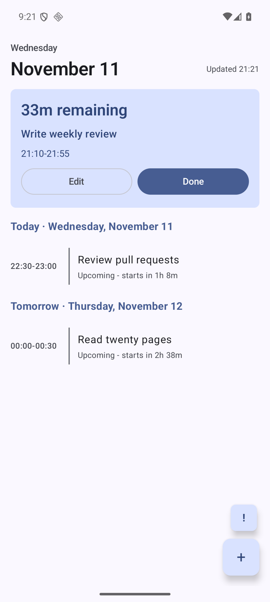
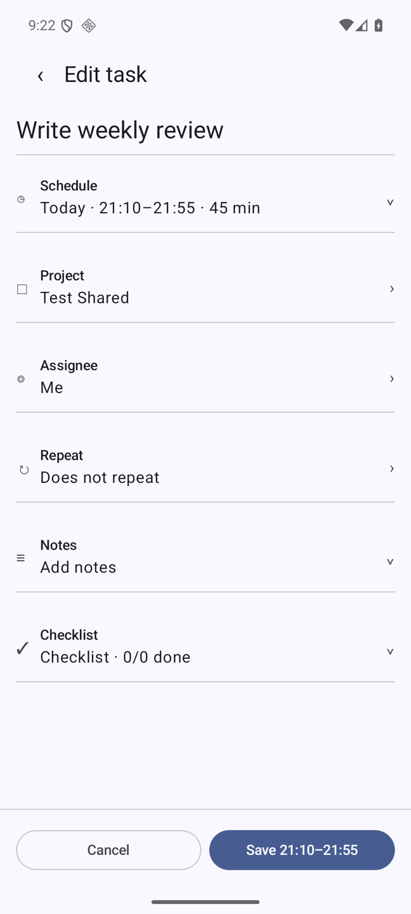
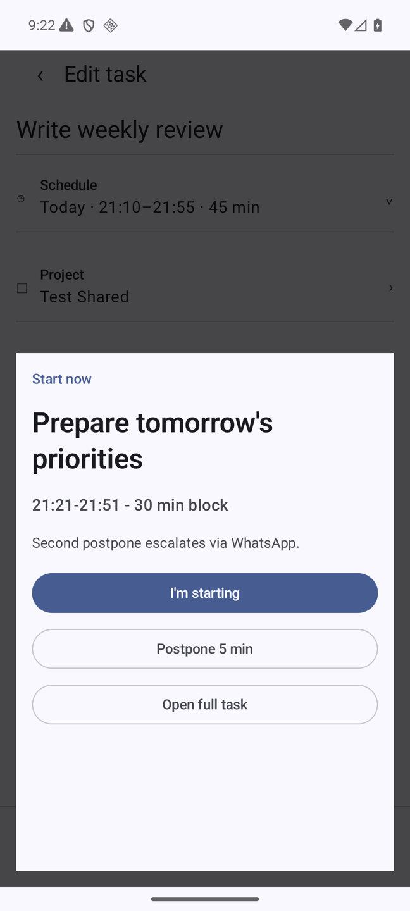
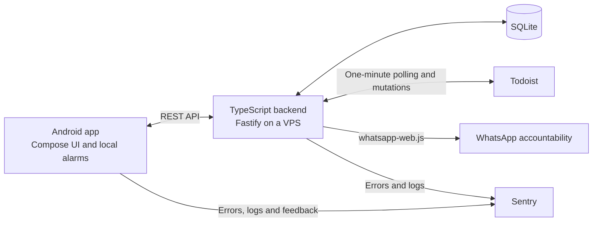

# Buzer

**Accountability, with witnesses.**

[](https://github.com/SvehlaJan/buzer-app/actions/workflows/ci.yml)

My Todoist had become a beautifully organized cemetery for good intentions. I built Buzer to make creating and managing tasks easier—and ignoring them harder. Postpone the task too many times, and it sends a WhatsApp message to my friends. Accountability, with witnesses.

Buzer is a personal Android companion for Todoist: faster task capture, scheduled work blocks, persistent start and deadline prompts, and social accountability. I use it to block time for the work on my plate and actually finish it.

**Built with:** Kotlin Multiplatform · Compose Multiplatform · Android native APIs · TypeScript · Fastify · SQLite · Sentry

## The app

| Plan the work | Make the commitment | Start when it matters |
| :---: | :---: | :---: |
|  |  |  |

Current app captures using local fixture data. [Capture details](docs/images/README.md).

- **Capture and edit commitments:** choose a project, assignee, start time, and duration; manage notes and checklists in the same flow.
- **Act at the right time:** Android schedules alarms locally, with start and deadline blockers, a morning review, and checks for permissions needed to deliver them.
- **Make postponement visible:** the second start postponement triggers a WhatsApp accountability message to a configured recipient.
- **Keep Todoist as the task system:** the backend syncs task data every minute and owns Buzer's enforcement state.

This is a personal, single-user tool deployed on my Android phone and VPS. Android is the shipped client; the shared Kotlin module does not imply an iOS or desktop release.

## My role

I own the product direction, author and review the specifications, and make the architectural tradeoffs. AI agents handle implementation. My responsibility is to define the right problem, challenge proposals, and decide which guarantees are worth maintaining.

An important example was reversing a design I had initially approved. Automatic mutation recovery grew into a protocol of journals, replay, reconciliation, and persistent pending states. I chose bounded operations and explicit uncertainty instead, accepting manual recovery in uncommon failure cases. [Read the engineering case study](docs/case-studies/simplifying-mutations.md).

## How I build with AI

My workflow starts with ideas captured in Linear. Agents perform initial research, then interview me to clarify requirements and develop the PRD and technical specification. Implementation follows the reviewed specifications, with test and review checkpoints.

I enjoy using [Matt Pocock's skills and development framework](https://github.com/mattpocock/skills) to structure that collaboration. Earlier in the project I used [Superpowers](https://github.com/obra/superpowers); its specs and plans remain in this repository's history.

The most useful lesson has been to apply KISS deliberately. Generating an elaborate solution is easy; understanding, testing, and maintaining every guarantee remains expensive. I keep the requirements and tradeoffs explicit so I can direct the work and change course when necessary.

## Engineering decisions worth exploring

| Decision | Judgment behind it | Evidence |
| --- | --- | --- |
| Simplify mutation recovery | Remove durable reconciliation while preserving bounded retries, revision checks, and honest failure states. | [Case study](docs/case-studies/simplifying-mutations.md) · [Decision](docs/decisions/2026-08-30-level-1-mutation-simplification.md) |
| Use native Sentry capabilities | I asked agents to replace a custom diagnostic platform with native capture, feedback, and direct triage. | [Design and rejected alternatives](docs/superpowers/specs/2026-08-22-lean-observability-design.md) |
| Reduce scope before delivery | I challenged the expanding Home proposal, cut secondary features and state handling, and split the remaining work into three stages. | [Recorded scope review](docs/handoffs/2026-08-02-smart-home-design.md#scope-review-revision) |
| Resolve time at one boundary | Normalize floating Todoist times on the backend and isolate malformed task times so one task cannot prevent the whole alarm plan. | [Reliability decision](docs/decisions/2026-09-29-reminder-reliability.md) · [Time tests](backend/test/domain/time.test.ts) |

## Architecture



- **Todoist** owns task content, assignment, schedule, and completion.
- **The backend** mirrors Todoist in SQLite and stores enforcement state. One process-local FIFO serializes Todoist polling, mutations, and explicit refreshes.
- **Android** owns alarm timing and blocker presentation. Cached schedules allow existing alarms to fire when the backend is unavailable; network-dependent actions report failures visibly.
- **Sentry** provides diagnostic capture and triage. Buzer adds sanitized logs and identifiers rather than maintaining a separate telemetry service.

The implementation is split between [`client/`](client) and [`backend/`](backend). The [original product spec](docs/superpowers/specs/2026-04-30-todoist-commitment-companion-design.md) records the starting point; [later decisions](docs/decisions) amend it, notably [Todoist start-time semantics](docs/decisions/2026-07-05-todoist-native-due-semantics.md) and [mutation handling](docs/decisions/2026-08-30-level-1-mutation-simplification.md).

## Verification

[CI](.github/workflows/ci.yml) runs backend tests, type checking, and build, plus shared/Android JVM tests and Android debug assembly on pushes. Android instrumentation runs separately through [`scripts/e2e-real-backend.sh`](scripts/e2e-real-backend.sh).

The instrumentation harness runs the real backend and SQLite with a simulated Todoist adapter and dry-run accountability sender. It exercises app behavior without modifying real tasks or sending WhatsApp messages.

Some useful entry points:

- [Queue deadlines and cancellation](backend/test/services/todoistOperationQueue.test.ts)
- [Retry identity, rejection, and rate limits](backend/test/services/todoistCommandExecutor.test.ts)
- [Mutation success, uncertainty, and stale snapshots](backend/test/services/taskMutationRunner.test.ts)
- [Shared alarm planning](client/shared/src/commonTest/kotlin/app/buzer/shared/enforcement/AlarmPlanCalculatorTest.kt)
- [Android scenarios against the real backend](client/androidApp/src/androidTest/kotlin/app/buzer/android/blockers/RealBackendScenarioTest.kt)

## Run locally

For backend verification, use Node.js 22:

```bash
cd backend
npm ci
npm test
npm run typecheck
npm run build
```

For client verification, install JDK 17 and the Android SDK platform required by [`client/androidApp/build.gradle.kts`](client/androidApp/build.gradle.kts):

```bash
cd client
./gradlew :shared:testAndroidHostTest :androidApp:testDebugUnitTest :androidApp:assembleDebug
```

Running against your own Todoist account requires backend credentials and a matching Android API token. Sentry is optional and WhatsApp supports dry-run mode. For configuration, fixture-backend setup, and instrumentation commands, see [local development](docs/notes/local-development.md). For deployments, see [the VPS guide](docs/notes/vps-deployment.md).

## What's next

AI-powered voice input, to make capturing a commitment even easier. It is planned, not implemented.

## Working on this repository

[AGENTS.md](AGENTS.md) defines the working agreement and verification requirements. [Decisions](docs/decisions), [specifications and plans](docs/superpowers), and [session handoffs](docs/handoffs) preserve the reasoning behind the code.
